# Hiring Panel

A local job-application workbench built on Claude. Paste a job link and it:

1. has **seven independent reviewers** try to reject your resume for that posting (an applicant-tracking screen, a hiring manager, a rival applicant, a CEO, a 30-second recruiter and a future teammate),
2. **rebuilds the resume** for the posting from facts in your resume, your profile, your GitHub repositories and your portfolio site, and compiles it to a **one-page LaTeX PDF**,
3. suggests **short projects** that close the gaps the panel found, aimed at the hiring company,
4. writes the **application email, outreach sequence, referral ask, follow-ups and form answers**,
5. tracks every application on a **Kanban board**, with **evals** that check nothing on the resume is invented and a **cost ledger** for every model call.

It never invents a fact. A resume line that needs something it doesn't know is held back from the PDF and turned into a question for you.

## Demo

[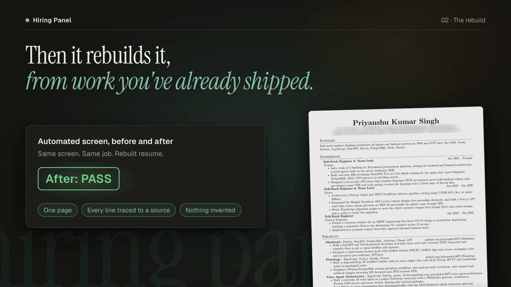](docs/media/hiring-panel-demo.mp4)

*A silent 22-second launch film (click the image to play): the panel rejects the resume, the rebuild turns the automated screen from REJECT to PASS, then the outreach sequence and the board. Made with [Hyperframes](https://hyperframes.heygen.com) in the app's dark theme from its real screens; contact details are blurred.*

## Walkthrough

One job, from posting to tracked application. Screenshots use demo data: company, people and contact details are placeholders, and every answer, draft and verdict shown is real model output.

**1. Start a run.** Pick a resume (yours, or one the panel already improved), paste a job link or posting, and choose whether to research the company and draft outreach.

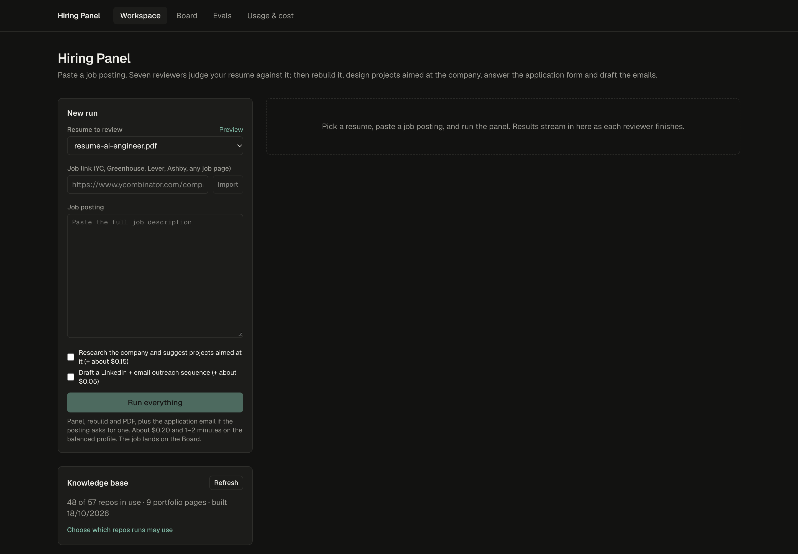

**2. Seven reviewers judge it alone.** Each verdict streams in as it lands. The automated screen re-runs on the rebuilt resume, so you see before and after.

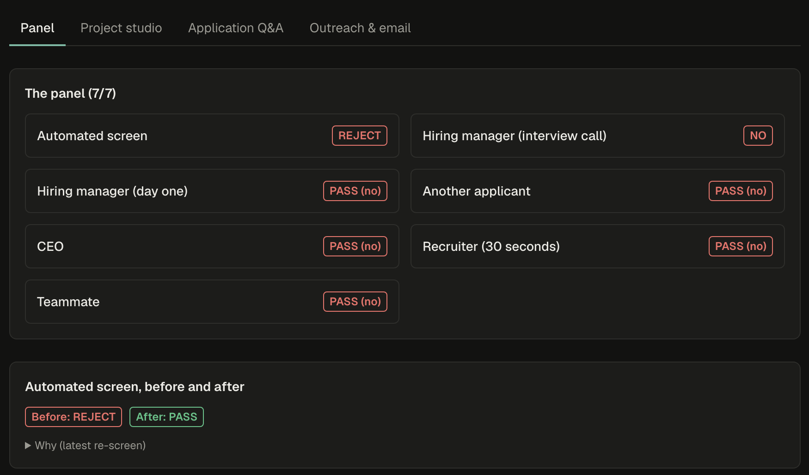

**3. What is wrong, worst first.** Every mistake quotes the line it is about and names the reviewers who flagged it.

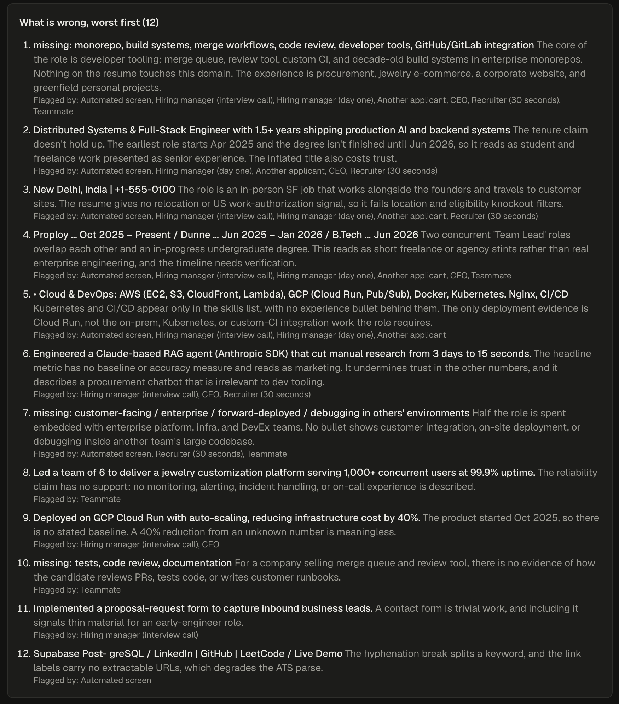

**4. Projects that close the gaps.** Short builds aimed at the posting, often extending a repo you already have.

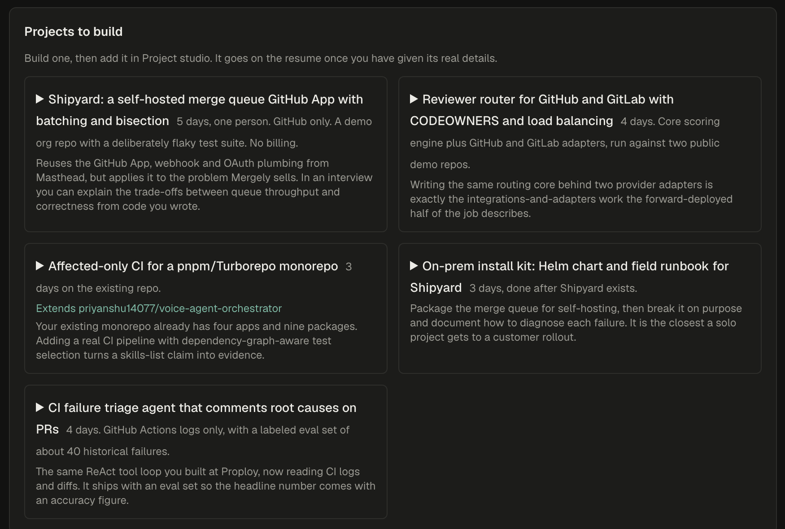

**5. Questions instead of invented facts.** Lines that need something you haven't said are held back from the PDF until you answer.

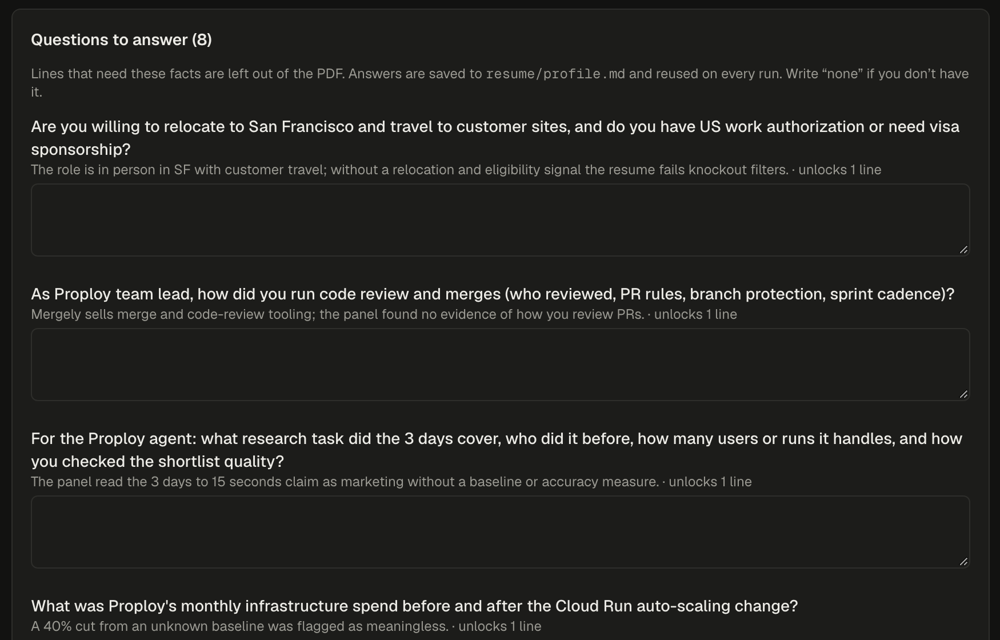

**6. Project studio.** Web research on the company, then project ideas that mirror its product and customers.

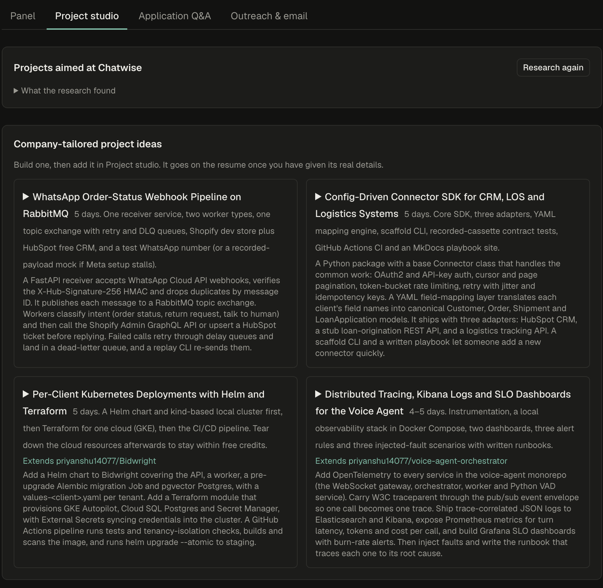

**7. Add what you built.** Give the real details and the resume and PDF are rebuilt with it.

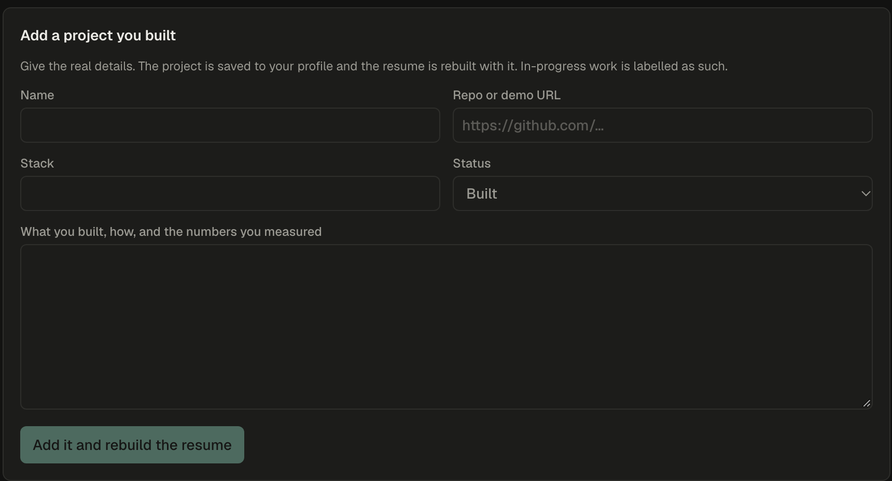

**8. Application Q&A.** Form answers in your voice, from your real work, inside the word limit.

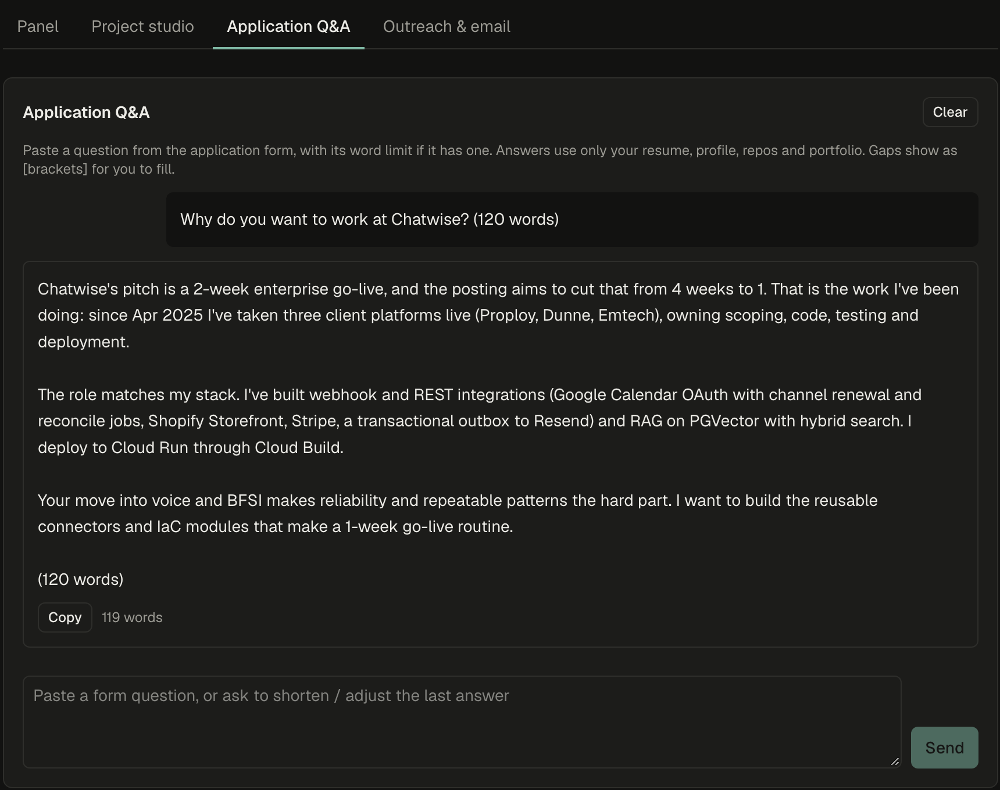

**9. Outreach.** A 10-day LinkedIn and email sequence to a founder, engineer or recruiter, with LinkedIn's character limits enforced.

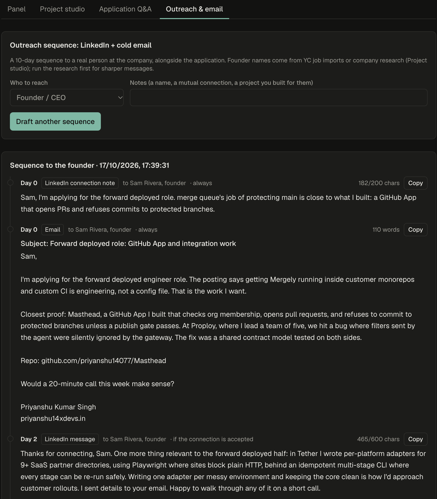

**10. Track it on the board.** Each card shows the screen verdict, failed evals, fit risk, cost and what is due today.

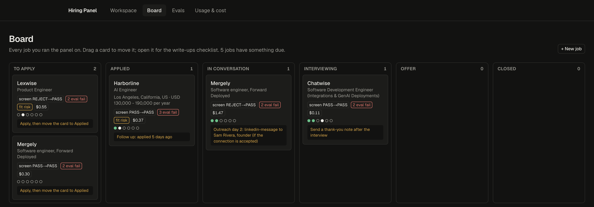

**11. Evals.** Pass rates across runs for grounding, one-page, placeholder and writing checks.

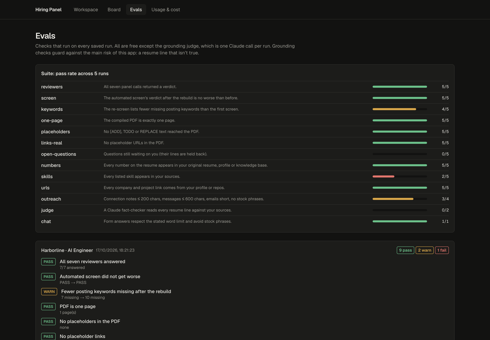

**12. Usage and cost.** Every model call priced, by feature and by run.

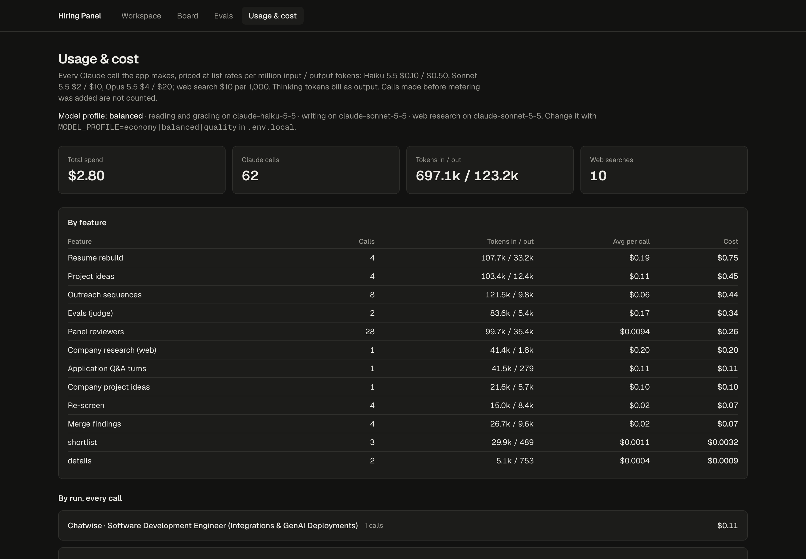

---

## Contents

- [Demo](#demo)
- [Walkthrough](#walkthrough)
- [Features](#features)
- [Architecture](#architecture)
- [Requirements](#requirements)
- [Setup](#setup)
- [Your data folder](#your-data-folder)
- [Using it](#using-it)
- [Configuration](#configuration)
- [Models and cost](#models-and-cost)
- [Evals](#evals)
- [Project structure](#project-structure)
- [Scripts](#scripts)
- [Deployment](#deployment)
- [Credits](#credits)

---

## Features

**Workspace**

- **Paste a job link, run everything.** YC, Greenhouse, Lever and Ashby pages are parsed from their schema.org `JobPosting`. YC links also bring in the company's batch, team size and founders with their LinkedIn URLs. Other pages fall back to plain text, and client-rendered pages are rendered in headless Chrome.
- **Job details** extracted at a glance: location, salary, experience, must-haves, stack, how to apply, any email or form questions the posting asks for, and fit risks for where you live.
- **The panel**: seven reviewers run in parallel and stream in as each finishes. None sees another's notes.
- **Rebuilt resume**: mistakes listed worst first, the resume rewritten in the posting's vocabulary, the 2-4 best-fitting projects picked from your GitHub, then compiled to an ATS-parsable one-page PDF with [Jake's Resume](https://github.com/jakegut/resume). The automated screen re-runs on the new version so you see before and after.
- **Open questions**: facts the rebuild needs from you. Answers are saved to your profile and reused on every later run.
- **Review an improved PDF**: the resume picker lists your own PDFs and every PDF the pipeline compiled (newest first, labelled with the job), with a Preview link. Run the panel on an improved version to check the rebuild holds up. For the same posting, the next rebuild goes back into that PDF's folder and the previous version moves to `archive/`, so nothing is overwritten. Grounding evals always check against the original resume the chain started from.

**Project studio**

- Researches the company on the web (product, customers, integrations, stack, recent launches) and designs 3-5 projects that mirror its product and close your gaps, often by extending a repo you already have.
- Add a project you built, with its real details, and the resume and PDF are rebuilt with it.

**Application Q&A**

- A chat that answers application-form questions as you, in plain technical language, from your real work. It respects word limits and puts any missing fact in `[brackets]` for you to fill.

**Outreach & email**

- A 10-day LinkedIn plus cold-email sequence to a founder, engineer or recruiter. Connection notes are kept under LinkedIn's 200-character limit, enforced in code.
- Single drafts: application email, referral request, follow-up, post-interview thank-you.

**Board**

- Kanban columns: *To apply → Applied → In conversation → Interviewing → Offer → Closed*.
- Each card shows location, salary, screen verdict, failed evals, fit risk, cost, and what is due today (follow up 5 days after applying, the next outreach step on its day, a thank-you after an interview).
- A write-ups checklist per job with Draft, Copy and Mark sent.

**Knowledge base**

- Reads every non-fork repo you own or can read in your GitHub orgs (README, manifests, languages, your commit count) and every page of your portfolio site, and distils each repo into a card: what it is, stack, skills with evidence, resume-ready lines and maturity. Repos where you have no commits start excluded, and you can switch any repo on or off.

**Evals and Usage**

- Deterministic checks on every run plus an optional Claude fact-checker. See [Evals](#evals).
- Every model call is priced and grouped by feature and by run.

---

## Architecture

### System overview

The app is a Next.js server that sits between your browser, Anthropic's API, a few local command-line tools and a data folder on your disk. Long jobs stream their progress to the browser as newline-delimited JSON.

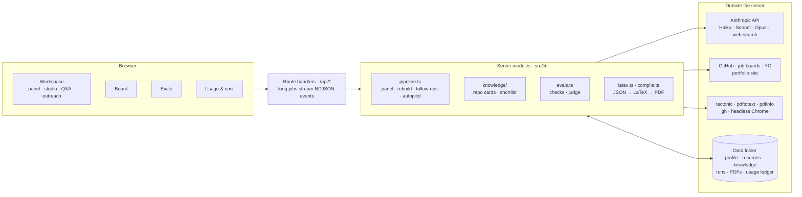

### One run, from a job link

`/api/autopilot` chains everything. The job details, the repo shortlist and the seven reviewers start together, so the cheap steps add no wait.

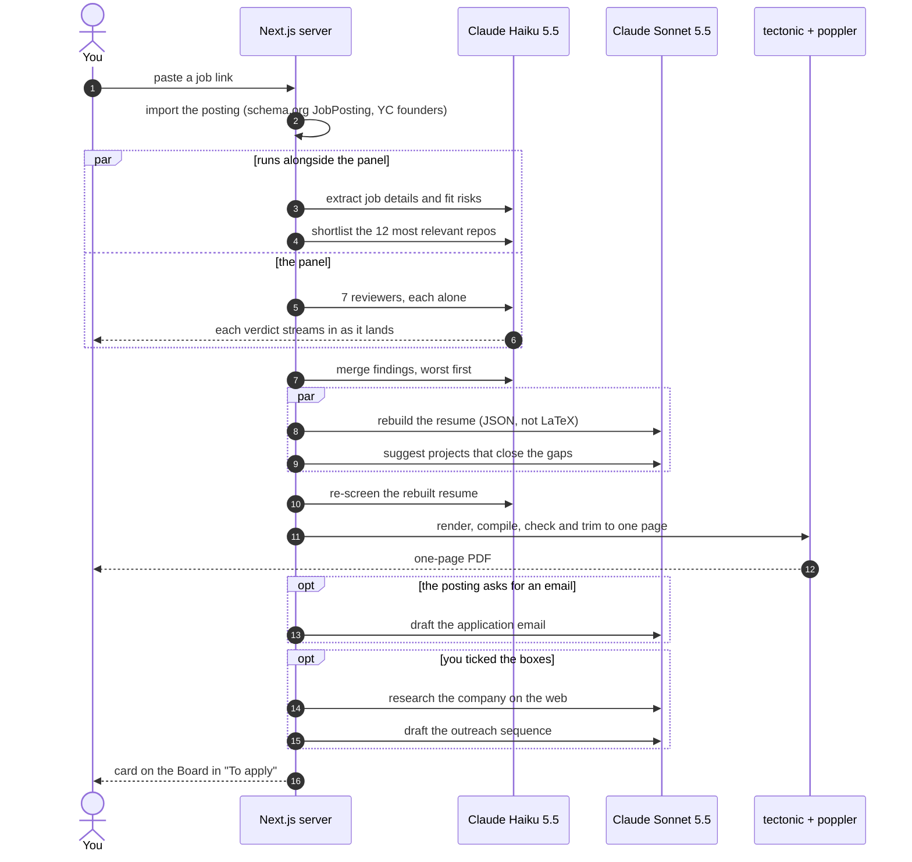

### How a resume line stays honest

The rebuild returns structured JSON. A line that depends on something you haven't said carries a `[[needs:question-id]]` marker. The renderer leaves it out of the PDF and asks you instead. The model never writes LaTeX: code escapes and renders it, then trims the lowest-ranked lines until `pdfinfo` reports one page.

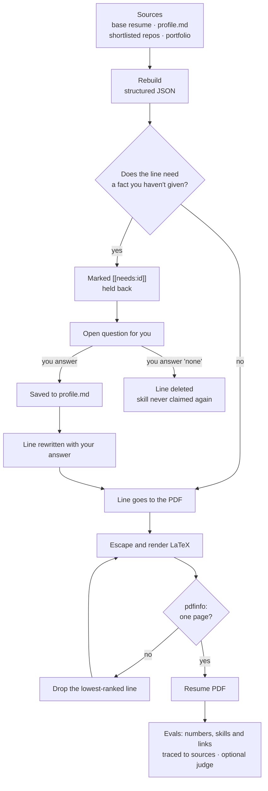

### Which model does what

Each call names the kind of work it needs, and `MODEL_PROFILE` maps that to a model. Web search needs Sonnet or Opus, so research never runs on Haiku.

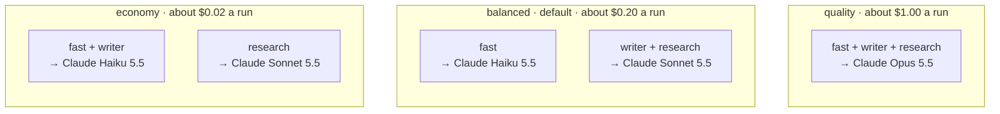

| Tier | Calls | Haiku 5.5 | Sonnet 5.5 | Opus 5.5 |
|---|---|---|---|---|
| **fast** | reviewers, re-screen, findings, job details, repo shortlist, repo cards | economy, balanced | | quality |
| **writer** | rebuild, project ideas, chat, email, outreach, judge | economy | balanced | quality |
| **research** | company web search | | economy, balanced | quality |

List prices per million input / output tokens: Haiku 5.5 $0.10 / $0.50, Sonnet 5.5 $2 / $10, Opus 5.5 $4 / $20.


A Haiku refusal is retried once on Sonnet in code. Sonnet and Opus retry refusals server-side with `fallbacks: "default"`.

### An application on the Board

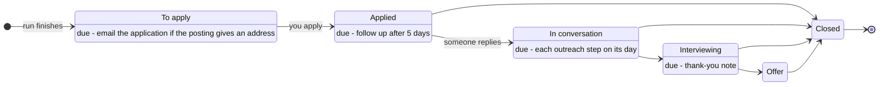

---

## Requirements

| Tool | Why | Install (macOS) |
|---|---|---|
| Node.js 20+ | runs the app | `brew install node` |
| An Anthropic API key | every model call | [console.anthropic.com](https://console.anthropic.com) |
| `tectonic` | compiles the LaTeX resume | `brew install tectonic` |
| poppler (`pdftotext`, `pdfinfo`) | reads your resume PDF, checks the output | `brew install poppler` |
| GitHub CLI `gh`, logged in | builds the knowledge base from your repos | `brew install gh && gh auth login` |
| Google Chrome | renders client-side portfolio and job pages | already installed, or set `CHROME_PATH` |

The knowledge base and Chrome are optional: without them the app still runs, using only your resume and profile.

---

## Setup

```bash
git clone <this repo> panel-app
cd panel-app
npm install
cp .env.local.example .env.local   # paste your API key
npm run dev                         # http://localhost:3000
```

`.env.local` is git-ignored. Never commit it.

---

## Your data folder

Your data lives **outside the repo**, in the folder that contains `panel-app/` (override with `JOB_HUNT_ROOT`):

```
job-hunt/
├── panel-app/                  this repo
├── resume/
│   ├── my_resume.pdf           one or more base resumes to choose from
│   ├── profile.md              your facts, links and answers (see below)
│   └── knowledge/              built by the app: knowledge.json, knowledge.md
├── job descriptions/<job>/     job_description.md (imported links are saved here)
├── .hiring-panel/<run>/        run.json, PANEL.md, RESUME-IMPROVED.md; usage.jsonl
└── improved resume/<job-id>/   resume.tex and the PDF
```

### `profile.md`

The rebuild may use anything here as a fact you stated. The `Contact` section is parsed for the PDF header:

```markdown
## Contact
- Name: Jane Doe
- Location: Springfield, USA
- Phone: +1-555-0100
- Email: jane@example.com
- Portfolio: https://jane.dev
- LinkedIn: https://www.linkedin.com/in/janedoe/
- GitHub: https://github.com/janedoe
- LeetCode: https://leetcode.com/u/janedoe

## Open questions
- Java: none
- CI/CD: GitHub Actions running pytest and Alembic migrations on every PR
```

Write `none` for a skill you don't have, and the app will never claim it or ask about it again. The app appends sections such as `Answers given in the panel app` and `Projects added in the panel app` itself.

The same folder layout is used by the `/hiring-panel` Claude Code skill, so runs from either show up in both.

---

## Using it

1. **Build the knowledge base** (sidebar, once). One cheap call per repo; later refreshes only re-read repos you pushed to since.
2. **Paste a job link** into *Job link* and click **Import the link and run everything**. Tick the boxes to also research the company and draft outreach.
3. **Read the panel**, then answer the **open questions** to unlock the lines held back from the PDF.
4. **Run the grounding judge** on the Evals page before sending a resume.
5. **Project studio**: research the company, pick an idea, build it, then add its real details to get a rebuilt resume.
6. **Application Q&A**: paste each form question with its word limit.
7. **Board**: move the card as the application progresses, mark write-ups sent, and do what each card says is due.

---

## Configuration

| Variable | Default | Purpose |
|---|---|---|
| `ANTHROPIC_API_KEY` | (required) | Anthropic API key |
| `MODEL_PROFILE` | `balanced` | `economy`, `balanced` or `quality` (see below) |
| `JOB_HUNT_ROOT` | the folder above the app | where your data folder lives |
| `RESUME_TEMPLATE` | `templates/jake-resume.tex` | a different LaTeX template with the same commands |
| `CHROME_PATH` | macOS Chrome path | Chrome binary for rendering pages |

`MODEL_PROFILE` is read when the server starts. Restart `npm run dev` after changing it.

---

## Models and cost

Each call names what it needs, and the profile picks the model:

| Profile | Reading and grading (reviewers, re-screen, findings, details, shortlist, repo cards) | Writing (rebuild, ideas, chat, email, outreach, judge) | Web research | Full run, measured |
|---|---|---|---|---|
| `economy` | Claude Haiku 5.5 | Claude Haiku 5.5 | Claude Sonnet 5.5 | not measured (roughly $0.02) |
| `balanced` | Claude Haiku 5.5 | Claude Sonnet 5.5 | Claude Sonnet 5.5 | **about $0.20** |
| `quality` | Claude Opus 5.5 | Claude Opus 5.5 | Claude Opus 5.5 | about $1.00 |

Ways it keeps cost down:

- **Repo shortlist**: each run picks the 12 repos most relevant to the posting, so writing calls read about 6k tokens of knowledge base instead of all of it.
- **Chat caching**: the candidate material is cached, so follow-up chat turns re-read it at a tenth of the price.
- **Refusal handling**: Sonnet and Opus retry a safety refusal server-side on Anthropic's recommended model. Haiku has no server-side fallback, so its refusals are retried once on Sonnet.

Rough add-on costs on `balanced`: company research about $0.15, an outreach sequence about $0.05, the grounding judge about $0.05. The **Usage & cost** page shows real numbers from `.hiring-panel/usage.jsonl`.

---

## Evals

Free checks on every run:

| Check | Fails when |
|---|---|
| Reviewers | any of the seven calls errored |
| Screen | the automated screen's verdict got worse after the rebuild |
| Keywords | more posting keywords are missing after the rebuild *and* the verdict got worse (a higher count alone is a warning: the two lists come from separate calls) |
| One page / placeholders / links | the PDF isn't one page, contains `[ADD`, `TODO` or `REPLACE`, or has a placeholder URL |
| Numbers | a number on the resume doesn't appear in your resume, profile or knowledge base |
| Skills | listed skills can't be found in your sources (warn for 1-2, fail for more) |
| URLs | a company or project link didn't come from your profile or repos |
| Writing | the latest email, outreach sequence or form answer breaks a length limit or uses a stock phrase |

Plus the optional **grounding judge**: Claude reads every resume line against your sources and marks it supported, partly supported or unsupported, quoting the evidence.

---

## Project structure

```
src/
├── app/
│   ├── page.tsx               workspace: new run, panel, studio, Q&A, outreach tabs
│   ├── board/                 Kanban board and write-ups drawer
│   ├── evals/                 eval results and the grounding judge
│   ├── usage/                 cost ledger
│   ├── nav.tsx, layout.tsx    navbar
│   ├── knowledge-panel.tsx    build and curate the knowledge base
│   └── api/                   route handlers; long jobs stream NDJSON events
├── lib/
│   ├── claude.ts              model tiers, fallbacks, structured output, web research, chat
│   ├── pipeline.ts            the panel, rebuild, PDF, follow-up actions, autopilot, board
│   ├── reviewers.ts           the seven reviewer briefs
│   ├── schemas.ts             structured-output schemas (kept small and flat)
│   ├── latex.ts, compile.ts   JSON → LaTeX → tectonic → checked PDF
│   ├── evals.ts               checks and the grounding judge
│   ├── import-job.ts          job link import, YC company data
│   ├── knowledge/             GitHub and portfolio collectors, project cards, shortlist
│   ├── usage.ts               pricing and the usage ledger
│   └── files.ts, paths.ts     profile, resumes, saved jobs, data folders
templates/                     Jake's Resume (MIT)
scripts/                       offline and live check scripts
```

Structured-output schemas compile into a grammar on Anthropic's side, and a large nested schema is rejected ("compiled grammar is too large"). The rebuild is therefore split across several small schemas. Run `scripts/schema-check.mts` after changing one.

---

## Scripts

| Command | Calls Claude | What it does |
|---|---|---|
| `npx tsx scripts/render-fixture.mts` | no | renders a fixture resume through LaTeX and the PDF checks |
| `npx tsx scripts/refit-run.mts ../.hiring-panel/<run>/run.json` | no | recompiles a saved run's PDF with the current renderer |
| `npx tsx scripts/collect-check.mts [portfolio-url]` | no | exercises the GitHub and portfolio collectors |
| `JOB_HUNT_ROOT=<scratch> npx tsx scripts/archive-check.mts <run.json>` | no | compiles a run's resume twice into one folder and shows the archived copy |
| `npx tsx scripts/schema-check.mts` | yes (export the key first) | confirms every schema compiles on the tier it runs on |

---

## Deployment

The app is built to run locally. It reads and writes your data folder, shells out to `tectonic`, `pdftotext`, `gh` and Chrome, and spends your API key, so a public deployment needs storage, those binaries, and authentication in front of it. Vercel deployment notes will be added in a follow-up.

---

## Credits

- Resume layout: [Jake's Resume](https://github.com/jakegut/resume) by Jake Gutierrez, MIT (`templates/LICENSE-jake-resume`).
- The seven-reviewer panel follows the [hiring-panel skill](https://github.com/alexyc9381/hiring-panel-skill) by Alex Chen, MIT.
- Built with [Next.js](https://nextjs.org) and the [Anthropic TypeScript SDK](https://github.com/anthropics/anthropic-sdk-typescript).
- Demo video type: [Instrument Serif](https://github.com/Instrument/instrument-serif) and [Geist](https://github.com/vercel/geist-font), both SIL Open Font License.
