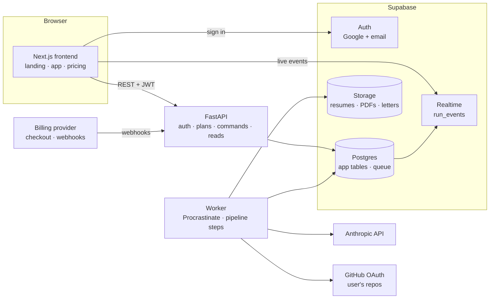

# Hiring Panel as a product: architecture and plan

Status: **paused on 2026-10-19** by the owner, before any code was written. Pricing, plans, the FastAPI port, Supabase and Paddle are all on hold; the app stays the local Next.js tool. **(decided)** marks the owner's choices; everything else is a recommendation to confirm.

**To resume:** reread §13 (decisions log) and the two open questions in §14. Nothing is set up yet: no Supabase project, no Paddle application, no `backend/` folder.

## 1. What changes

Hiring Panel goes from a local tool for one person to a hosted product with accounts and paid plans. That means:

- many users, each seeing only their own data;
- runs that are asynchronous, parallel and durable;
- a Python backend (FastAPI, SQLAlchemy) **(decided)**, with the Next.js app becoming the frontend only;
- cover letters and CVs alongside resumes **(decided)**;
- two plans, Free and Pro, with limits enforced by the backend, and bring-your-own-key on Pro **(decided)**.

## 2. Architecture



| Part | Choice | Why |
|---|---|---|
| Frontend | Next.js 16, UI only, on Vercel | No binaries or disk needed once the pipeline moves out, so Vercel works |
| API | FastAPI, Python 3.13, Pydantic v2 **(decided)** | Typed request and response models, async, OpenAPI for a generated TS client |
| ORM and migrations | SQLAlchemy 2.0 (async, asyncpg) and Alembic **(decided)** | Models in code, migrations versioned |
| Database | Supabase Postgres **(decided)** | Also holds the queue, so there is one stateful service |
| Auth | Supabase Auth: Google, plus email magic link **(decided: Supabase)** | FastAPI verifies the Supabase JWT on every request |
| Files | Supabase Storage, private buckets, signed URLs | Resumes and PDFs are personal data |
| Queue | Procrastinate (Postgres-backed, asyncio) | Python's equivalent of pg-boss: retries, locks, periodic tasks, no Redis |
| Live updates | Supabase Realtime on `run_events`, with RLS | No WebSocket server of our own |
| Worker | Same Python package, separate process | Runs pipeline steps; holds the binaries |
| Hosting | Vercel for the frontend; Fly.io for `api` and `worker` (one image, two process groups) | The pipeline needs tectonic, poppler and Chromium |
| Billing | Paddle (merchant of record) **(decided)** | Stripe is invite-only for new Indian businesses; Paddle handles global tax |
| Email | Resend | Welcome, run finished when push is off, plan changes |
| Observability | Sentry, structured JSON logs, PostHog, Better Stack uptime | Errors, funnels (sign-up to first run to paid), uptime |

### Backend isolation

```
backend/
├── app/
│   ├── api/          FastAPI routers: auth deps, validation, enqueue, reads. No pipeline logic
│   ├── core/         domain: runs, steps, prompts, schemas, plans. No FastAPI, no SQLAlchemy, no I/O
│   ├── ports/        interfaces: RunRepo, BlobStore, EventBus, Queue, Llm, Tools, Billing, Clock
│   ├── infra/        adapters: SQLAlchemy repos, Supabase Storage, Procrastinate, Anthropic, tectonic, poppler, Playwright, GitHub, web-push, billing
│   ├── worker/       Procrastinate tasks: wire infra into core, run steps
│   └── db/           SQLAlchemy models, session, Alembic env
├── alembic/versions/
├── templates/        LaTeX: resume (Jake's), CV and cover letter (Awesome-CV)
└── tests/            core with in-memory fakes; api with a test database
frontend/             the current Next.js app, minus src/lib/pipeline and its API routes
```

Rules: `core` imports nothing from `api`, `infra`, FastAPI or SQLAlchemy. `api` never calls a step. Import Linter enforces both in CI.

### Data access and multi-tenancy

- Every table has `user_id`. FastAPI connects as a server role and must filter every query by the caller's `user_id`. A repository layer does this and tests check it; a cross-user read test runs in CI.
- RLS stays on for the tables the browser reads directly (`run_events` through Realtime, plus Storage objects): `user_id = auth.uid()`.
- The service-role key lives only in `api` and `worker`.

### Alembic with Supabase

- Alembic manages the `public` schema only. `env.py` filters out `auth`, `storage`, `realtime`, `extensions` and Procrastinate's tables, so autogenerate never proposes dropping Supabase's objects.
- Autogenerate misses RLS policies, triggers, functions and grants. Those are written by hand in the migration, and every autogenerated migration is read before it runs.
- Procrastinate's own schema is applied with its CLI in a dedicated migration step.

## 3. Async runs (event-driven)

Unchanged in substance from the earlier plan, now in Python.

- **Commands** (start a run, answer questions, research, add a project, write a cover letter or CV, draft email or outreach, judge, cancel, retry). The API validates each command, checks the plan's entitlement and quota, then in one transaction inserts or updates the run and defers a Procrastinate job.
- **One job per command.** The job runs named steps. The seven reviewers stay parallel inside their step.
- **Checkpoints.** `run_steps(run_id, job_id, name, status, attempt, cost_usd, error)`, unique per job and step. Done steps are skipped on retry, and each step writes only its own columns in the same transaction as its event. That also fixes the old overwrite bug.
- **Events.** Append-only `run_events(id, run_id, user_id, seq, type, payload, at)`. The browser loads the run snapshot, then subscribes through Realtime from `last_seq`.
- **Retries.** Transient model and network errors retry inside the step with backoff; permanent errors fail the job, and the Runs page offers Retry. Procrastinate retries worker crashes.
- **Cancel.** A flag checked between steps; the in-flight model call is aborted.
- **Duplicates.** A Procrastinate queueing lock per `run_id:command` stops double clicks from queueing twice.
- **Concurrency.** Per-plan run concurrency (see §5), a worker-wide semaphore on in-flight model calls, and a per-key limit for BYOK keys.
- **Budget.** A platform-wide daily spend cap, plus each plan's monthly allowance, checked before every step.
- **Notifications.** Web Push on done, needs an answer, failed or limit reached; email as a fallback.
- **Chat stays live.** Application Q&A streams over a direct request (FastAPI SSE), metered per message.

## 4. Documents

| Document | Template | Engine | Plan |
|---|---|---|---|
| Resume, one page | Jake's Resume, the current one (MIT) | pdfLaTeX through tectonic | Free (1 run) and Pro |
| Cover letter | Awesome-CV `coverletter` class (LPPL-1.3c) | XeLaTeX through tectonic | Pro |
| CV, multi-page | Awesome-CV `cv` class (LPPL-1.3c) | XeLaTeX through tectonic | Pro, after launch |
| Alternative look | moderncv (LPPL-1.3c), CV and letter | pdfLaTeX | Later, as a style choice |

Templates checked:

| Template | License | Notes |
|---|---|---|
| [posquit0/Awesome-CV](https://github.com/posquit0/Awesome-CV) | LPPL-1.3c | ~28.7k stars, pushed 2026-09; ships matched `resume`, `cv` and `coverletter` examples |
| [moderncv/moderncv](https://github.com/moderncv/moderncv) | LPPL-1.3c | Maintained, pushed 2026-09; CV plus letter |
| [jakegut/resume](https://github.com/jakegut/resume) | MIT | Archived, which is fine for a fixed template we vendor |
| liantze/AltaCV | no SPDX license detected | Skip until the license is clear |

Cover letters follow the rebuild's rules: only facts from the user's sources, held-back lines become questions, one page, a word limit (250–400), and the posting's vocabulary. A CV runs the same grounding, plus sections a resume drops: education detail, publications, talks, all roles. It gets a 2–4 page limit instead of one.

LPPL notes: rendering PDFs on our servers is fine, and the PDFs aren't covered by the license. If we change a `.cls` and publish it (the repo is public), the modified file needs a new name and a note saying it changed. Vendor the files unmodified and put changes in our own `.sty` where possible.

Container additions for Awesome-CV: the fonts it loads (Roboto and Source Sans 3) and FontAwesome, which `fontawesome6` provides through the tectonic bundle. Pre-warm the tectonic cache for both engines at image build.

## 5. Plans: Free and Pro **(decided: two plans)**

| | Free | Pro |
|---|---|---|
| Price (draft) | $0 | ~$12/mo, INR at about 40% (to confirm) |
| Runs | 1, lifetime **(decided)** | ~30/mo on our key; unlimited with BYOK, under a fair-use rate limit **(decided)** |
| Panel review, rebuilt one-page resume PDF, open questions, evals | ✓ | ✓ |
| Cover letters | one teaser per run: first paragraph shown, the rest blurred **(decided)** | ✓ |
| Emails, Application Q&A, board | – | ✓ |
| Company research, project studio, outreach sequences | – | ✓ |
| GitHub and portfolio knowledge base | public repos | ✓ |
| CV (multi-page) | – | later, as a Pro update **(decided)** |
| Batch import, runs at once | –, 1 | ✓, 3 |
| Bring your own key | – | ✓, Anthropic keys only at first **(decided)** |

A run means the panel plus the rebuilt resume and PDF. Follow-ups on a run (answers, research, letters, outreach) don't count as new runs, but Pro still has a fair-use cap on them when it runs on our key.

Our cost per action, measured (Sonnet 5.5 writes, Haiku 5.5 grades): core run ~$0.19, company research ~$0.20 ($0 when reused within 30 days), outreach ~$0.06 then ~$0.02 per extra target, email or cover letter ~$0.03–0.05 (estimated), CV ~$0.25 (estimated), chat message ~$0.01–0.05. The free run (panel, resume and the cover letter teaser) therefore costs about $0.25 per sign-up.

### 5.1 Bring your own key (BYOK)

Pro users can paste their own Anthropic API key. Their runs are then billed to their Anthropic account, not ours.

**Options considered**

| Option | What it is | Fit |
|---|---|---|
| **Build it in the backend (recommended)** | Store the key encrypted, decrypt it in the worker, pass `api_key` to the Anthropic client for that job | Keeps every Anthropic-specific feature we depend on: structured outputs, server-side web search, prompt caching, the refusal fallback. No extra hop or service |
| [LiteLLM](https://docs.litellm.ai/docs/proxy/clientside_auth) (open source) | Proxy or Python SDK that accepts a per-request `api_key` across 100+ providers; BYOK through [forwarded provider headers](https://docs.litellm.ai/docs/proxy/forward_client_headers) | Worth it only to support OpenAI or Gemini keys too. Adds a translation layer that may not carry Anthropic betas, and our prompts and schemas are tuned for Claude |
| [Portkey gateway](https://docs1.portkey.ai/docs/product/ai-gateway/virtual-keys) (open-source core) | Encrypted key vault with virtual keys | The vault is documented for Portkey's hosted product; not confirmed in the self-hosted gateway |
| [OpenRouter BYOK](https://openrouter.ai/announcements/bring-your-own-api-keys) | Users bring an OpenRouter key that reaches many models | A third-party hop and fee terms that have changed several times ([2025 update](https://openrouter.ai/announcements/1-million-free-byok-requests-per-month)); lose direct Anthropic features |

**Design (build it)**

- **Storage:** [Supabase Vault](https://supabase.com/blog/supabase-vault) (encrypted at rest; the root key never enters SQL), or app-level envelope encryption with a key held in Fly secrets. A `provider_keys(user_id, provider, vault_secret_id, last4, status, verified_at)` table, RLS-protected; plaintext read only by the worker's server-side function.
- **Validation:** when a key is saved, make one cheap call (list models). Store only `last4` and the status; never echo the key back.
- **Use:** the worker resolves the key per job: BYOK if active, otherwise ours within the plan allowance. **Never fall back to our key silently** when a BYOK call fails; fail the step and tell the user.
- **Errors:** 401 marks the key invalid and notifies the user. 429 respects the user's own Anthropic rate tier: per-key concurrency starts low and backs off.
- **Metering:** usage is still recorded per call, flagged `billed_to = user_key`, so users see their spend and we don't count it against our margin.
- **Advice in the UI:** create a dedicated key in an Anthropic workspace with a spend limit.
- **Never logged:** keys are redacted in logs, Sentry and error messages.
- **Later:** multi-provider BYOK through the LiteLLM SDK, with prompts checked per model.

## 6. Product requirements a public launch adds

- **Per-user GitHub.** Today `gh` uses the owner's login. Users connect GitHub with OAuth (read-only; private repos opt-in), and the token is stored encrypted.
- **Portfolio crawl per user**, rate-limited, with the same headless browser.
- **Onboarding.** Sign in, upload a resume, a short profile interview (the facts `profile.md` holds today), optionally connect GitHub, then the first run. The first free run should land in under 3 minutes.
- **Profile editor**, replacing hand-edited `profile.md`.
- **Pricing page** on the landing, an upgrade prompt at the limit, and a billing portal.
- **Legal:** terms, a privacy policy, data export and account deletion. India's DPDP Act 2023 applies; GDPR applies if EU users sign up.
- **Abuse.** Free-run farming: Google or verified email only, one free allowance per verified identity, rate limits on sign-up and runs. Prompt injection: job postings are untrusted text and already sit inside delimiters; never let a posting change tools or limits.
- **Support:** a contact form, admin views of users, runs and spend, and a refund path.
- **Model spend is the main variable cost.** Track gross margin per plan weekly from the `usage` table.

## 7. Services

| Service | Needed for | Stage |
|---|---|---|
| Supabase | Postgres, Auth, Storage, Realtime | Now (local via `supabase start`, cloud for staging) |
| Google Cloud OAuth client | Google sign-in through Supabase | Now |
| Anthropic API | Every model call | Now (exists) |
| Fly.io | `api` and `worker` containers | Staging |
| Vercel | Frontend | Staging |
| GitHub OAuth app | Users connect their repos | Before launch |
| Paddle | Subscriptions, checkout, tax, webhooks | Before launch (§8) |
| Resend | Transactional email | Before launch |
| Sentry, PostHog, Better Stack | Errors, analytics, uptime | Staging |
| Domain + DNS (Cloudflare) | `hiringpanel.<tld>`, HTTPS for push | Before launch |
| VAPID keys | Web Push | Now (generated) |

Not needed: Redis, a hosted queue, a separate search engine.

## 8. Billing provider: Paddle **(decided)**

Chosen for a global customer base with a solo founder in India: Paddle is the merchant of record, so it collects and remits VAT, GST and sales tax and issues invoices. The owner applies; Paddle reviews the business before approval.

Background:

Stripe accounts are invite-only for new businesses in India ([Stripe support](https://support.stripe.com/questions/stripe-accounts-are-invite-only-in-india)), and new onboarding needs video KYC from 2026-01-01 ([Stripe](https://support.stripe.com/questions/video-kyc-for-india-onboarding)).

| Option | For | Against |
|---|---|---|
| Paddle (merchant of record) | Handles global sales tax/VAT/GST and invoicing; works for Indian founders selling abroad | ~5% + fee; Paddle reviews your business before approval |
| Lemon Squeezy (MoR, Stripe-owned) | Simple, also merchant of record | Similar fees; check it accepts Indian payouts today |
| Razorpay Subscriptions | Best for Indian customers (UPI, cards, INR) | You handle tax for foreign customers; weaker outside India |
| Stripe | Best API | Invite-only in India |

The billing adapter sits behind the `Billing` port: webhooks map to `subscriptions(user_id, plan, status, period_end, provider_ref)`, and entitlements read only that table.

## 9. Container

One Python image, two commands (`uvicorn app.api.main:app` and `procrastinate worker`).

| Install | Why |
|---|---|
| Python 3.13, `uv` | Runtime and locked dependencies |
| tectonic, with the cache pre-warmed for the resume, CV and cover letter | LaTeX → PDF; no downloads at runtime |
| Fonts: Roboto, Source Sans 3, FontAwesome | Awesome-CV |
| poppler-utils | `pdftotext`, `pdfinfo` |
| Playwright Chromium + fonts-noto | Job pages and portfolios that render client-side |
| ca-certificates, tzdata, tini, a non-root user | TLS, plan periods by time zone, clean shutdown, safety |

No `gh` CLI: GitHub is called over HTTPS with each user's token.

## 10. Migration from the current app: port in steps behind golden tests **(decided)**

1. Freeze features on the TypeScript pipeline.
2. Port `src/lib` (~2,350 lines: pipeline, prompts, schemas, LaTeX, evals, knowledge, import, usage) to `backend/app/core` and `infra`, step by step, with golden tests that compare outputs on saved runs.
3. Expose the same endpoints from FastAPI; generate a TS client from OpenAPI; point the frontend at it.
4. Import the owner's existing runs, usage and profile into Postgres under the owner's account.
5. Delete the TypeScript pipeline and its API routes.

## 11. Milestones

| | Delivers |
|---|---|
| P0 | Repo split into `backend/` and `frontend/`; local Supabase; FastAPI skeleton with JWT auth; SQLAlchemy models and the first Alembic migration |
| P1 | Pipeline ported to Python behind ports; golden tests pass on saved runs |
| P2 | Procrastinate worker, checkpointed steps, events, Realtime, Runs page; parallel runs |
| P3 | Plans and entitlements, quota checks, free allowance, upgrade prompts (billing mocked) |
| P4 | Cover letters (Awesome-CV), the free-tier teaser, BYOK (Anthropic) |
| P5 | Onboarding, profile editor, per-user GitHub OAuth, account deletion and export |
| P6 | Billing provider live, pricing page, webhooks |
| P7 | Staging on Fly and Vercel, observability, legal pages, beta with 10–20 users |
| P8 | CVs for Pro; multi-provider BYOK through LiteLLM if users ask |

## 12. Who does what

| Task | Owner | Claude |
|---|---|---|
| Plan prices, limits, positioning; final say on the matrix | ✓ | drafts, models costs |
| Supabase projects (local and cloud), Google OAuth client, redirect URLs | ✓ | guides |
| Billing provider application and KYC | ✓ | integration |
| Write the RLS policies and the cross-user access tests | ✓ (suggested) | reviews |
| Review every Alembic migration before it runs | ✓ | drafts |
| Port the evals module to Python, as a first Python piece | ✓ (suggested) | reviews, pairs |
| BYOK key settings page and validation call | ✓ (suggested) | reviews |
| Pipeline port, worker, events, entitlements, documents | | ✓ |
| Cover letter and CV prompts | together | drafts |
| Terms and privacy policy | ✓ (a lawyer or a vetted template) | drafts a first pass |
| Beta users, interviews, pricing tests | ✓ | analysis |

## 13. Decisions log

- 2026-10-19: FastAPI, SQLAlchemy and Alembic backend; Supabase for Postgres, Auth, Storage and Realtime; cover letters and CVs.
- 2026-10-19: two plans only (Free and Pro); free is 2 runs lifetime; BYOK on Pro; global market from India through Paddle; port the backend in steps behind golden tests.
- 2026-10-19: free is 1 run lifetime, not 2 (supersedes the entry above).
- 2026-10-19: Pro includes ~30 runs a month on our key, unlimited with BYOK; Anthropic keys only at first; CVs after launch; the free run gets the panel, the resume and a blurred cover letter teaser.

## 14. Open questions

1. Is ~$12/month right for Pro (INR at about 40%)?
2. Commit this doc and start P0 (repo split, FastAPI skeleton with Supabase sign-in, first migration) on a new branch?
