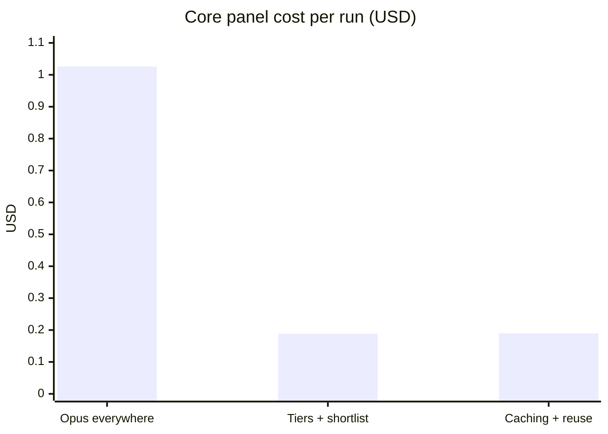
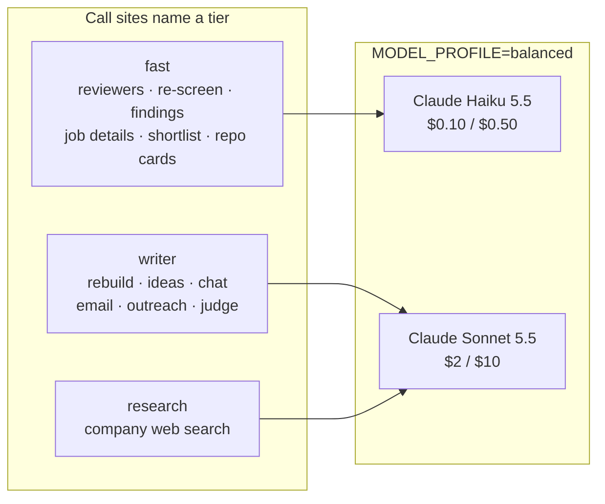
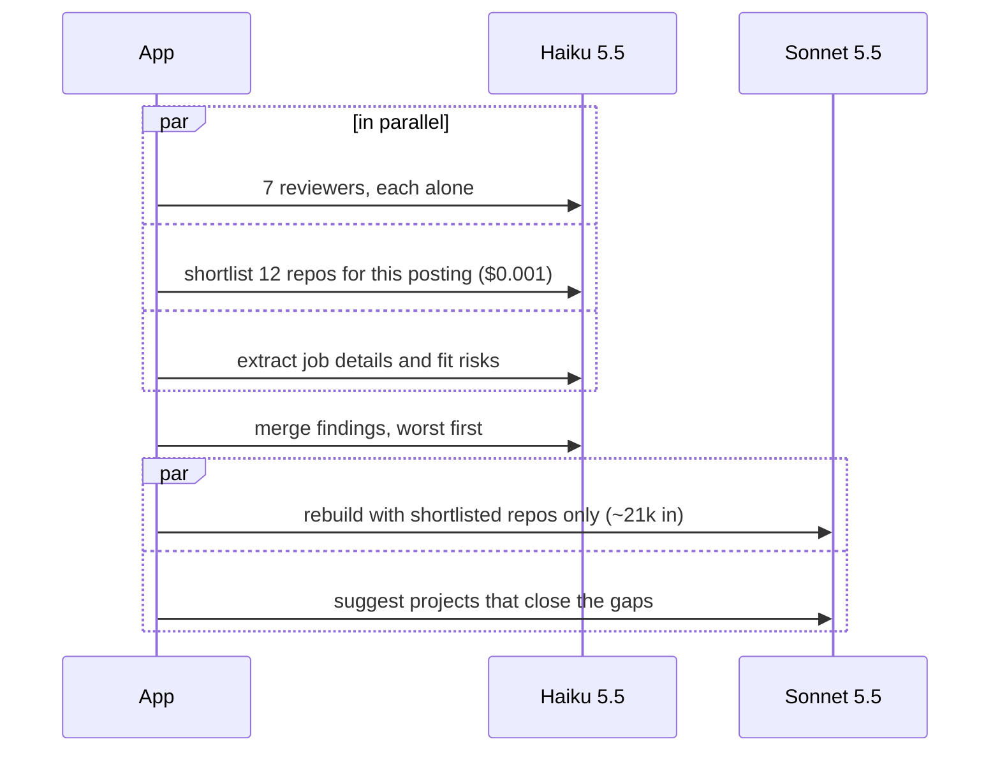
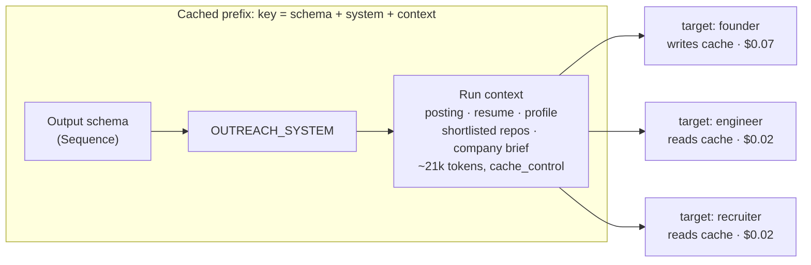
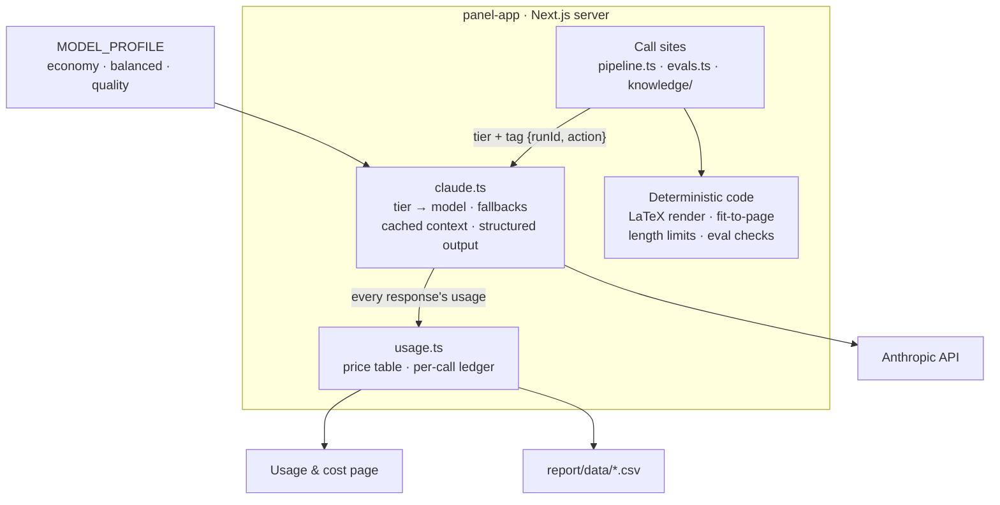

# Cutting an AI agent's cost per run by 81%: a case study

**Project:** Hiring Panel (`panel-app/`). This is a local Next.js agent. It has seven AI reviewers try to reject a resume for one job posting, rebuilds the resume into a one-page PDF from facts the candidate has already shipped, researches the company, and drafts outreach.
**Period:** 2026-10-17 to 2026-10-18
**Evidence:** every number below comes from the app's own usage ledger (`.hiring-panel/usage.jsonl`), which records one line per API call with its token counts and cost. The raw data is exported in [`data/`](data/).

## Results

| | Stage 1: everything on Opus | Stage 2: model tiers + repo shortlist | Stage 3: caching, reuse, effort tuning |
|---|---|---|---|
| Core panel (reviewers → rebuild → PDF) | **$1.026** | $0.188 | **$0.190** |
| Seven reviewers | $0.240 | $0.008 | $0.008 |
| Resume rebuild | $0.406 | $0.111 | $0.105 |
| Company research | not run | $0.231 | **$0** (reused) |
| Company-tailored project ideas | not run | $0.095 | $0.074 |
| Each extra outreach sequence | $0.213 | $0.057 | **~$0.02** (cache read) |
| Measured run | `120619`: $1.469 | `152434`: $0.571 | `160756`: $0.374 |

The core panel went from **$1.03 to $0.19 (−81%)**. Drafting outreach for another person at the same company went from **$0.21 to about $0.02 (−90%)**. Each stage-3 run did more work than the stage-1 run: it added web research, company-tailored ideas and three outreach sequences instead of one.

Throughout, the rebuilt resume passed the automated re-screen and compiled to exactly one page.



## The starting point

The first version sent every call to the strongest model, Claude Opus 5.5 ($4 input / $20 output per million tokens). Every writing call also carried the candidate's **entire** GitHub knowledge base. One run made 13 calls and read 203k input tokens. The rebuild alone read 42k tokens and wrote 12k.

Two things were wrong. Most calls didn't need a frontier model: a reviewer reading a one-page resume against a posting is a reading task. And most of the context was irrelevant: a backend posting doesn't need the summary of every side project.

## Stage 1 → 2: route each call to the cheapest model that can do it

### Model tiers

Each call states *what kind of work* it does instead of naming a model. One environment variable, `MODEL_PROFILE`, maps that kind of work to a model. Product code never names a model, so changing the trade-off is a one-line config change.



The seven reviewers moved to Haiku and went from **$0.240 to $0.008 per run, 30x cheaper**. Text the candidate will actually send stays on Sonnet.

The tiers come with a safety net for refusals. Sonnet and Opus use the API's server-side fallback, which retries a declined request on Anthropic's recommended model. Haiku has no server-side fallback, so the app retries a Haiku refusal once on Sonnet. A refusal costs one extra call instead of a failed run.

### Repo shortlist

While the seven reviewers are reading, a Haiku call picks the 12 repos most relevant to the posting. It costs **$0.001** and runs in parallel, so it adds no wait. Writing calls then read only those repos: about 9k tokens of knowledge base instead of all of it. The rebuild's input fell from **42k to about 21k tokens**.



### Never pay a model for work code can do

Several design choices keep output tokens out of the bill:

- **The model never writes LaTeX.** The rebuild returns small structured JSON (`ResumeDoc`). Code escapes it, renders the template and compiles it with tectonic.
- **Fitting to one page is a loop in code, not a model call.** If `pdfinfo` reports two pages, the code drops the lowest-ranked line and recompiles. Every pass is free.
- **Character limits are enforced in code.** LinkedIn notes have hard limits. A Haiku call ($0.0001) rewrites to a word budget, then code cuts at the last whole sentence. The expensive writer is never asked to try again.
- **Evals are deterministic first.** Numbers, skills and links in the PDF are traced back to their sources by code. The LLM grounding judge only runs when asked.
- **Schemas are small and flat.** A big nested schema failed with "compiled grammar is too large", so each call has its own minimal schema.

## Stage 2 → 3: prompt caching, reuse and effort

By stage 2 the core panel cost about $0.19. What remained came from **repeat work**: researching the same company again, and re-sending the same 21k-token context for each outreach target and email.

### First, measure what breaks the cache

Prompt caching re-reads a cached prefix at **0.1x** the input price. Writing it costs 1.25x, and it stays live for 5 minutes. The plan was to cache the shared context once and let the rebuild, ideas, email and outreach calls all read it.

Before writing any code, a probe ([`data/cache-probe.mts`](data/cache-probe.mts)) sent the same 11k-token cached context five times, changing one thing each time:

| Change from the first call | Cache read | Verdict |
|---|---|---|
| Different output schema | 0 (new write) | **breaks the cache** |
| No schema | 0 (new write) | **breaks the cache** |
| Effort `low` → `medium` | 11,375 | keeps the cache |
| Different system prompt | 0 (new write) | breaks the cache |

**The output schema is part of the cache key.** Rebuild, ideas, email and outreach each use a different schema, so they can never share a cache, however the prompt is arranged. The original plan would have paid the 1.25x write premium on every call and read the cache on none.

The design changed to match. **Cache only where the same action repeats on the same run**: outreach for several targets (founder, engineer, recruiter), several kinds of email, and chat turns. One-off calls like the rebuild don't cache, because caching would only add 25% to them.



In code, this is one optional `context` argument on the two request helpers. When it's passed, the material goes first in the user turn with `cache_control`, and the task-specific instruction follows it:

```ts
function userTurn(prompt: string, context?: string): Message {
  if (!context) return { role: "user", content: prompt };
  return {
    role: "user",
    content: [
      { type: "text", text: context, cache_control: { type: "ephemeral" } },
      { type: "text", text: prompt },
    ],
  };
}
```

**Result:** three outreach sequences read **41,894 cached tokens** (2 × 20,947) and cost **$0.110** in total. Without caching they cost about $0.17. Each one after the first costs about $0.02 instead of $0.06.

### Reuse company research

Web research was **a fifth of total spend**: about 44–50k input tokens of fetched pages plus up to 10 searches, roughly $0.20–0.23 a time. A company changes slowly, and candidates often apply to several roles at one company. Before searching, the app now looks for a brief on the same company from any run in the last 30 days. If it finds one, research costs **$0**, and the app labels the reused brief with its date.

### Effort tuning

Rebuild, company ideas and add-project dropped from `high` to `medium` effort, which was safe because the probe showed effort doesn't touch the cache. Company ideas fell from **$0.095 to $0.074**. The rebuild changed little (6.9k → 6.4k output tokens) because most of its output is the resume itself, not thinking.

### What was tried and rolled back

Capping web searches at 5 instead of 10 looked like an obvious saving. It was measured before shipping: it saved **$0.04** ($0.231 → $0.188), and the brief came back saying *"Search quota ran out partway through"* with whole sections marked unknown. Most research cost is fetched pages coming back as input, not the $0.01 per search, so the cap cut quality more than cost. It was reverted the same hour.

## The architecture that made this possible



1. **A ledger before any optimisation.** Every response's `usage` is priced and appended to `usage.jsonl`, tagged with the run and action, including cache reads, cache writes and web searches. Every decision in this report was made from that file, and the Usage & cost page shows it per run and per action.
2. **One gateway for model calls.** All requests go through `claude.ts`. Model choice, fallbacks, caching, structured output and usage recording live in one place, which is why each stage was a small diff.
3. **Tiers instead of model names.** Call sites declare what kind of work they do. The profile decides the model.
4. **Context is selected, not dumped.** A cheap Haiku shortlist decides what the expensive writer reads.
5. **Code owns everything deterministic.** Rendering, page fitting, limits and the first layer of evals are code, so retries are free.
6. **Measure, then ship.** The cache probe changed the design before any code was written, and the search cap was measured and reverted.

## What's left

- **Run project ideas on Haiku.** This would save about $0.07 per run, but the suggestions may be weaker. It's the biggest remaining line on the core panel.
- **Merge the rebuild and ideas into one call.** They read the same 21k context, but the schema is in the cache key, so they can't share it. Merging them would save about $0.04 per run, but the combined schema has hit the grammar size limit before.
- **The rebuild's output** (about 6–7k tokens) is now the largest single cost, and it's mostly the resume itself.

## Data and method

- [`data/runs.csv`](data/runs.csv): one row per run, with calls, tokens, cache reads, web searches, cost and actions.
- [`data/calls.csv`](data/calls.csv): one row per API call, straight from the ledger.
- [`data/cache-probe.mts`](data/cache-probe.mts): the probe that found what breaks the cache. Run it from `panel-app/` with `ANTHROPIC_API_KEY` set.
- Prices are list prices per million tokens: Haiku 5.5 $0.10 / $0.50, Sonnet 5.5 $2 / $10, Opus 5.5 $4 / $20. Cache writes are 1.25x and reads 0.1x; web search is $10 per 1,000 searches.
- Run IDs in the tables are the last six digits of the app's run IDs, for example `120619` = `2026-10-17-app-120619`. Stages 2 and 3 used the same job posting and base resume, so they compare like for like.
- Stage 1 has a single measured run. Runs before the ledger existed aren't counted.
